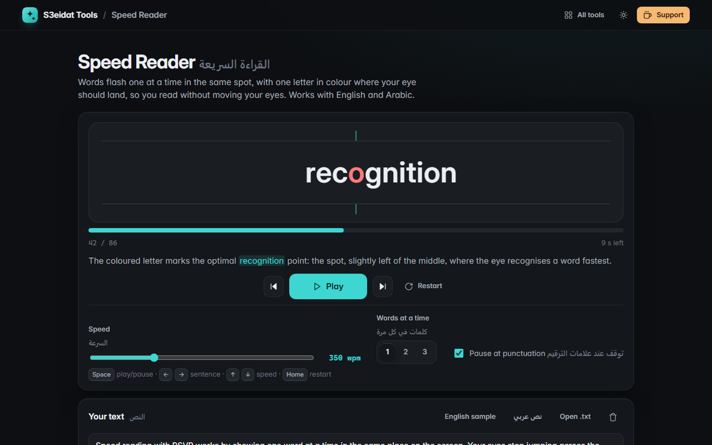

# Speed Reader · القراءة السريعة

> Read faster, one word at a time (RSVP), in English or Arabic. Free, private, and it runs entirely in your browser.

### ▶ [Open Speed Reader](https://s3eidat.github.io/speed-reader/)



## Features

- **RSVP reader**: words appear one at a time in the same spot, so your eyes don't travel along the line
- **Optimal recognition point**: one letter is coloured and lined up with the guide marks, slightly left of the word's middle (for Arabic, counted from the right)
- **100 to 1000 words per minute**, and **1, 2 or 3 words** at a time (chunks never run across a sentence or comma)
- **Pause at punctuation**: a little longer after commas, longer after sentences and paragraphs, and a touch longer for long words
- **Progress bar** you can click to jump, time left, and the current sentence shown while paused
- **Back / forward by sentence**, restart, and keyboard controls: Space, ← →, ↑ ↓, Home
- **Arabic right-to-left text**, with harakat kept on their letters
- Paste text or open a `.txt` file; your text, place and settings are remembered in this browser

## Privacy

Your text never leaves your device. There is no server, no account, no analytics.
The page ships with a strict Content-Security-Policy (`connect-src 'self'`), so the browser
itself blocks any attempt to send data anywhere.

## Run it yourself

It's plain HTML, CSS and JavaScript with no build step:

```bash
git clone https://github.com/s3eidat/speed-reader
cd speed-reader
python -m http.server 8000
```

Then open http://localhost:8000.

## Support

If this saved you time, **[buy me a coffee ☕](https://s3eidat.github.io/coffee/)**. It keeps every tool free.

---

Part of **[S3eidat Tools](https://s3eidat.github.io/)**: 100+ free, private tools that run in your browser. MIT licensed.
